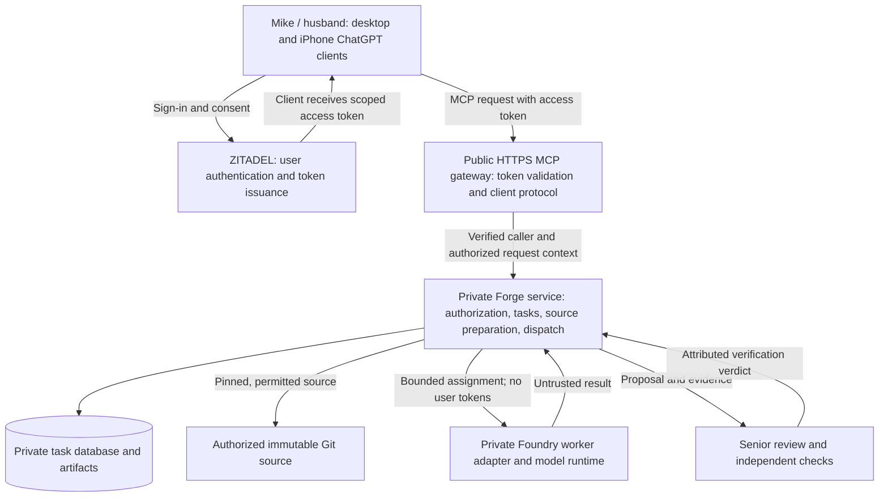

# Forge v2 architecture overview

Status: proposed architecture for review. Recorded 2026-11-18.
See the [specification index](README.md) for accepted direction and scope limits.

## Purpose

A shared authenticated service accepts engineering assignments from authorized
clients, prepares immutable source, dispatches bounded local work, and preserves
reviewable results independently of the originating chat or device.

Reuse the existing controller and contracts where they satisfy the requirements.
Do not assume v2 requires a rewrite, broker, microservices, or database migration.

## Logical components and trust boundaries

The gateway and service are logical boundaries; they may share a deployment if
authorization and isolation remain testable. Always-on Proxmox hosting is a
proposal. Foundry remains the preferred local inference host. See
[operations](operations.md) before choosing topology.

ARC-01: Validate identity at the gateway and enforce effective permissions at the
service. If separated, authenticate the gateway-to-service connection and protect
caller identity from forgery. A shared gateway credential must not collapse all
users into one task owner.

ARC-02: Models and repository contents are untrusted. They cannot grant access,
select new credentials, change routing, or authorize release actions.

ARC-03: Keep public ingress separate from private model, database, source, and
administrative services. Browser-only proxy login is not a substitute for the
OAuth access-token contract used by MCP clients.

ARC-04: ChatGPT/cloud clients process submitted and returned content. Hosting
execution at home does not mean all task data stays at home. Define and minimize
the source/results sent to each external service; do not send Forge task content
to the identity provider as login metadata.

## End-to-end workflow

1. A user connects through the [SSO workflow](sso.md).
2. The gateway validates the request token and the service checks user permissions.
3. Admission resolves an authorized source revision, captures context, validates
   limits, and commits a durable receipt before acknowledging acceptance.
4. The service queues the task and records a worker attempt.
5. The adapter supplies bounded context and enforces the worker protocol.
6. Result admission validates structure, source correspondence, and scope.
7. Senior review and independent checks establish correctness separately.
8. An authorized client retrieves the same task and evidence from another chat or
   device. Closing the original chat does not cancel accepted work.

For submission semantics see [MCP](mcp.md); for crash/retry semantics see
[service](service.md); for worker and verification contracts see [workers](workers.md).

## Source of truth and data ownership

| Record | Authority |
| --- | --- |
| Requirements, specs, source, configuration templates, reviewed changes | GitHub |
| Login credentials, factors, identity-provider sessions | ZITADEL |
| Forge identity mappings, grants, disable state | Forge-controlled authorization records |
| Tasks, attempts, receipts, lifecycle, review verdicts | Forge transactional database |
| Captured source packets, raw results, validation evidence | Private artifact storage, referenced from task records |
| Runtime credentials | Approved secret storage; never model context or Git |
| Current deployment identity and health | Actual running services and verified configuration |

Keep issuer/subject identity mappings stable independently of display names.
Database, artifact, and secrets products remain open choices. Existing SQLite
may remain suitable; evaluate requirements before adding infrastructure.

## Modular interfaces

ARC-05: Keep MCP transport, authorization, orchestration, source preparation,
worker adapters, and result validation behind explicit interfaces. Changing a
model must not change task ownership or client-facing task semantics.

ARC-06: Domain behavior remains in its domain repository. Forge supplies shared
engineering execution rather than absorbing Curator, Mechanic, or other agents'
business logic.

ARC-07: Independent validation initially means senior-run checks with recorded
evidence. A future automated runner is a separate isolated component, not shell
access for models or execution inside the controller.

## Review boundaries

Proposal generation, result admission, correctness review, patch application,
publication, merge, and deployment are distinct actions. Initial v2 does not add
autonomous writes, merges, deployment, or unrestricted commands.

Existing v1 task records retain their original meaning; v2 must not relabel v1
success as verified correctness. Coexistence and rollback belong to
[acceptance and migration](acceptance-migration.md).

## Open decisions

- Exact desktop/iPhone client products, versions, and account entitlements.
- Final hosting and external ingress.
- Identity mapping/grant administration and sharing policy.
- Persistence and recovery targets.
- Quantitative worker reliability and correction-effort targets.
- Whether automated isolated validation belongs in launch scope.
